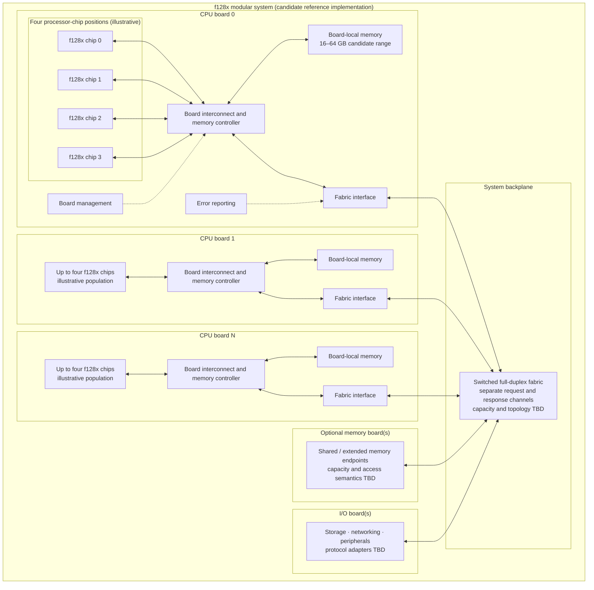
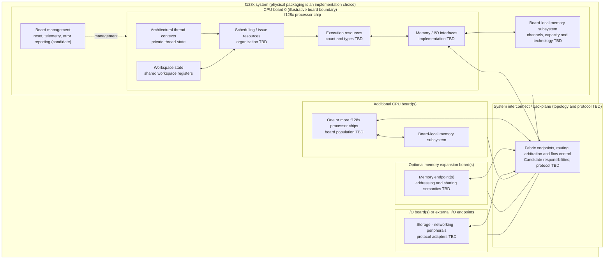
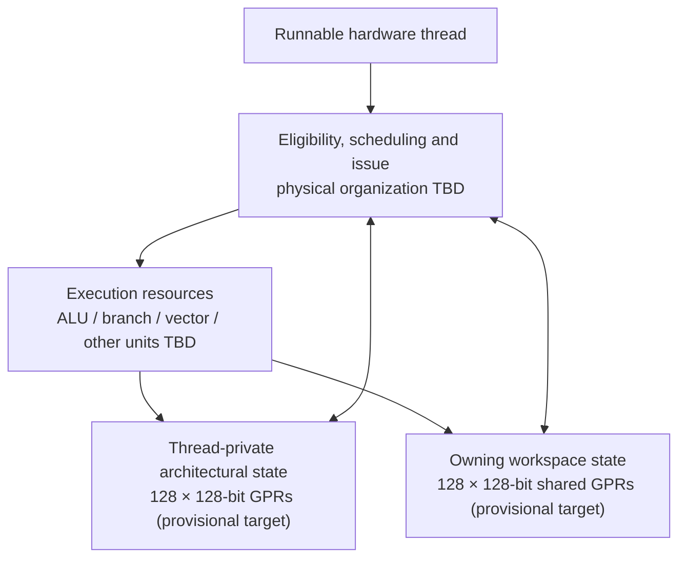

# f128x

f128x is a FlossWare processor-architecture research project. It began as a 128-bit successor exploration inspired by the Texas Instruments TMS9900 and its workspace-oriented programming model. The current direction explores a massively multithreaded, workspace-oriented general-purpose processor.

The project is not a TMS9900 ISA clone and does not promise TMS9900 binary compatibility. The f128x workspace is a proposed resource-sharing and protection abstraction, not the TMS9900's memory-resident register workspace. That terminology is under review.

## Current architectural direction

| Property | Provisional target |
|---|---:|
| Workspaces | 4,096 |
| Threads per workspace | 16 |
| Total architectural thread contexts | 65,536 |
| Private registers per thread | 128 × 128-bit |
| Shared registers per workspace | 128 × 128-bit |
| Aggregate architectural register storage | 136 MiB |

These are architectural capacity targets, not a requirement that every implementation physically instantiate all contexts or provide arbitrary simultaneous access to every register. Context residency, backing, register banking, and access semantics remain under investigation.

A first-order latency-hiding model treats 65,536 contexts as a hypothesis to test, not a proven requirement. The executable [scheduler simulation](tools/scheduler-sim/README.md) provides an initial cycle-level experiment. See also [Context capacity and latency model 0.2](docs/architecture/context-capacity-and-latency-model-0.2.md).

A 128-bit register does not imply 128-bit addresses, instructions, memory buses, or execution units. Those are independent design decisions.

## Reference implementation: chip, boards, and backplane

Expanded specification: [reference-implementation-block-diagram-0.1.md](docs/architecture/reference-implementation-block-diagram-0.1.md)

## Physical system: packaging boundaries

Expanded specification: [physical-system-block-diagram-0.1.md](docs/architecture/physical-system-block-diagram-0.1.md)

## Logical data paths: execution and memory

Expanded specification: [data-paths-0.1.md](docs/architecture/data-paths-0.1.md)

## Documentation

### Current architecture and review work
- [Review synthesis 0.2](docs/reviews/review-synthesis-0.2.md)
- [Context state and residency 0.2](docs/architecture/context-state-and-residency-0.2.md)
- [Context capacity and latency model 0.2](docs/architecture/context-capacity-and-latency-model-0.2.md)
- [Workspace protection and shared state 0.2](docs/architecture/workspace-protection-and-shared-state-0.2.md)
- [Scheduling progress and interrupts 0.2](docs/architecture/scheduling-progress-and-interrupts-0.2.md)
- [ISA, ABI, and toolchain plan 0.2](docs/architecture/isa-abi-and-toolchain-plan-0.2.md)
- [Scheduler simulation](tools/scheduler-sim/README.md)

### Architecture diagrams
- [Reference implementation block diagram 0.1](docs/architecture/reference-implementation-block-diagram-0.1.md)
- [Physical system block diagram 0.1](docs/architecture/physical-system-block-diagram-0.1.md)
- [Logical data paths 0.1](docs/architecture/data-paths-0.1.md)

### Architecture research baseline
- [Architecture overview 0.1](docs/architecture/overview-0.1.md)
- [Scheduling model research 0.1](docs/architecture/scheduling-model-0.1.md)
- [Historical architecture research 0.1](docs/research/historical-architectures-0.1.md)

### Platform and operating systems
- [Operating-system strategy 0.1](docs/platforms/os-strategy-0.1.md)
- [TI-99/4A platform strategy](docs/platforms/ti-99-4a.md)

### Planning
- [Roadmap](docs/roadmap.md)

### Historical documentation
- [Superseded architecture overview](docs/architecture/overview.md)
- [Historical register-file and workspace notes](docs/architecture/register-file.md)

## Historical research inputs

The current research priorities include:
- TMS9900: workspace-oriented register organization.
- Denelcor HEP and Tera/Cray MTA: fine-grained multithreading and latency hiding.
- CDC 6600: scoreboarding and functional-unit scheduling.
- INMOS Transputer: explicit communication between execution domains.
- XMOS XCore: practical hardware-thread implementation.
- Cray vector architectures: vector execution and memory throughput.

Historical mechanisms are research inputs, not automatic design requirements.

## Operating-system strategy

NetBSD is the preferred first full OS-porting candidate because of its history of supporting diverse architectures and its machine-dependent/machine-independent separation. DragonFly BSD is a high-priority kernel research reference, especially for scheduler layering, per-CPU scheduling, SMP, and NUMA-aware design. Neither OS choice is frozen. The OS must not treat 65,536 hardware contexts as 65,536 operating-system CPUs by default.

## Status

Architectural research and specification development. The workspace/thread capacity and register organization are provisional targets. Context residency, synchronization, memory model, ISA, ABI, scheduler microarchitecture, privilege architecture, and physical implementation are not frozen.
