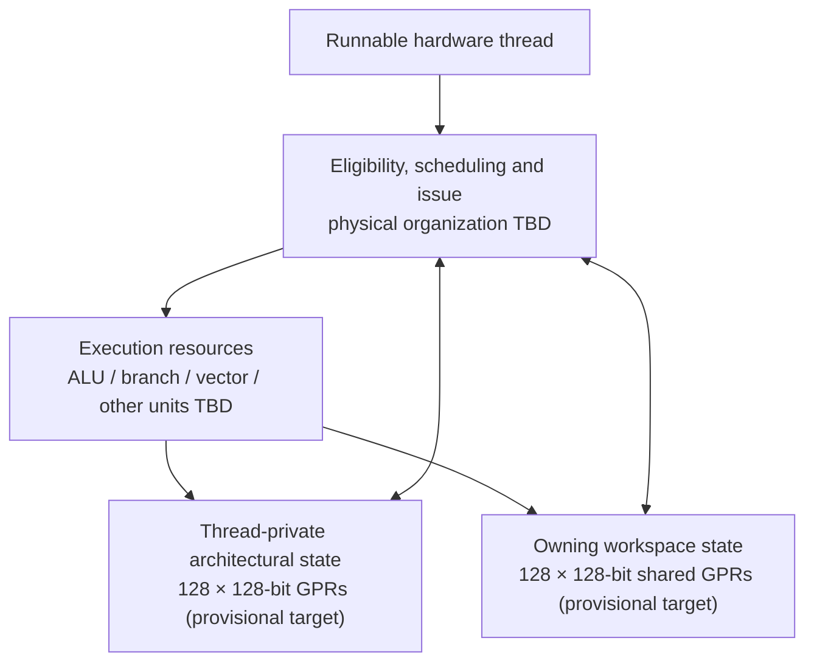
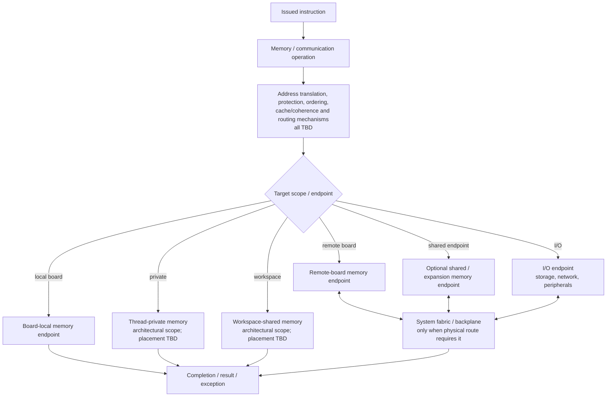

# f128x Logical Data Paths 0.1

**Date:** 2026-11-04  
**Status:** Conceptual architectural flow; memory placement and physical routing remain open

This view follows an instruction and its data through the architecture. It distinguishes architectural visibility from the physical location of storage. In particular, a private or workspace-shared memory scope does not yet imply a particular cache, SRAM, board, or backplane location.

## 1. Thread execution and register access

Private registers belong to one thread. Workspace-shared registers belong to the thread's owning workspace and are visible to its threads subject to synchronization, atomicity, and protection rules that still need specification.

The arrows represent logical operand/result movement, not a commitment to a particular register-file port, bypass network, or physical wire.

## 2. Memory and communication paths

The diagram is intentionally a set of candidate logical destinations. It does not yet define whether private/workspace memory is implemented in caches, local DRAM, scratchpad SRAM, or some combination. Nor does it define whether a workspace can span boards.

## 3. Physical route examples

| Operation | Architectural intent | Possible physical route |
|---|---|---|
| Read/write private GPR | Access the issuing thread's register | Thread state storage / register access network |
| Read/write workspace GPR | Access shared register state for the owning workspace | Workspace-state storage / shared-register access network |
| Private-memory access | Access memory private to a thread | Address translation and memory hierarchy; placement TBD |
| Workspace-memory access | Access memory shared within a workspace | Address translation and memory hierarchy; placement TBD |
| Board-local memory access | Access memory attached to the current board | Chip interface → board memory controller → local memory |
| Remote-board memory access | Access memory attached to another board | Chip interface → board endpoint → fabric → destination board memory controller |
| Shared-memory endpoint access | Access an optional system memory endpoint | Chip/board interface → fabric → memory endpoint |
| I/O operation | Communicate with a device | Chip/board interface → fabric or local I/O adapter → device |

## 4. Completion, ordering, and faults

A complete architecture must define when each operation becomes architecturally visible and what happens when it stalls or fails. Open specifications include:

- Load/store ordering and memory consistency.
- Atomic operation scope and atomicity guarantees.
- Cacheability, coherence, and DMA interaction.
- Translation, permissions, and protection faults.
- Retry, timeout, and fabric error behavior.
- Interrupt and exception delivery while requests are outstanding.
- Cancellation and precise completion semantics.
- Ordering between workspace-shared registers, memory, and communication operations.

The block diagram does not imply that all endpoints are coherent or that remote accesses are transparent. Those are explicit architecture decisions still to be made.

## 5. Relationship to the simulator

The current `BoardFabricSweep` experiment models only a narrow subset of the physical route:

1. A workspace is statically assigned to a home board.
2. A memory operation is classified as local or remote using a configured probability.
3. Local requests use the destination board's modeled memory service lane.
4. Remote requests use modeled request and response fabric service and the destination board's memory service lane.
5. A request remains outstanding until the modeled completion time.

It does not model the complete logical paths above. In particular, it does not model caches, coherence, translation, protection, I/O traffic, real routing, or the final ISA memory model. See [Board and backplane simulation 0.1](../research/board-backplane-simulation-0.1.md).

## Related material

- [Architecture overview 0.1](overview-0.1.md)
- [Physical system block diagram 0.1](physical-system-block-diagram-0.1.md)
- [Workspace protection and shared state 0.2](workspace-protection-and-shared-state-0.2.md)
