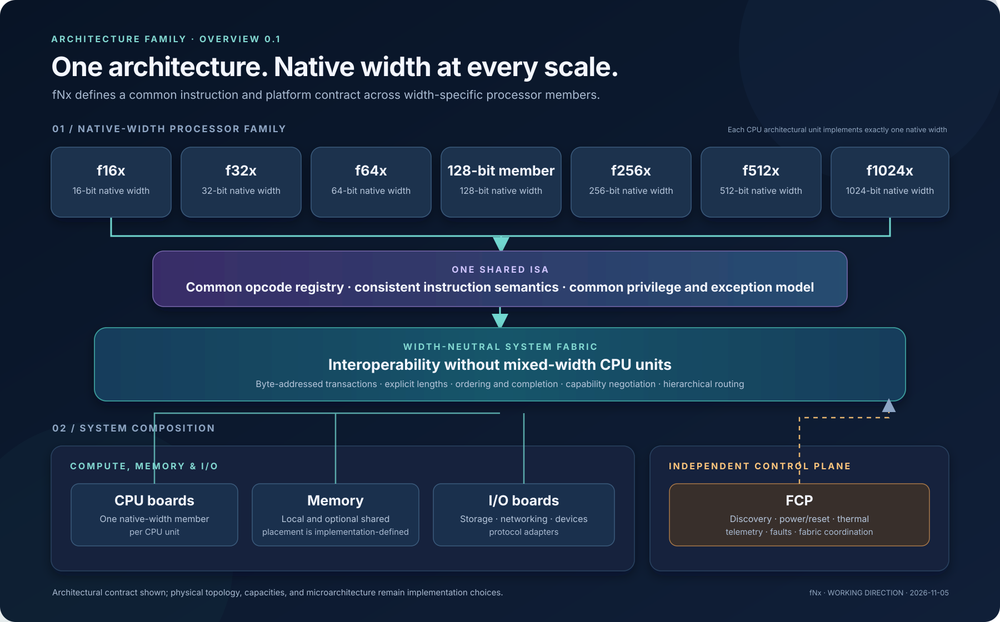

# fNx Architecture Family Overview 0.1

**Status:** Working architectural direction; conceptual overview, not a frozen ISA, microarchitecture, or physical platform specification.

**How to read this page:** The family overview describes shared architectural contracts across native-width members. It does not prescribe how those members are packaged or connected physically.

This diagram summarizes the family-level contract:

- Each CPU architectural unit implements exactly one native width.
- All family members share one ISA and one global opcode registry.
- Width-specific CPU units interoperate through a width-neutral, hierarchical system fabric.
- CPU boards, memory, and I/O attach through that fabric.
- The fNx Control Processor (FCP) provides an independent platform-management plane.

The widths shown are members of the explored family spectrum, not a statement that every width has the same implementation maturity or priority. The 128-bit member is shown descriptively because the family-level naming and profile conventions are still being normalized. The minimum native width, instruction encoding, physical topology, and implementation capacities remain open.

This is an architectural overview. It deliberately does not prescribe chip counts, cluster counts, memory capacities, link bandwidth, or latency.

## Related architecture material

- [Family and architectural contract](fnx-family-and-architectural-contract-0.1.md)
- [Physical system block diagram](physical-system-block-diagram-0.1.md)
- [fNx control and management plane](fnx-control-and-management-plane-0.1.md)
- [fNx P-Code and application compatibility](fnx-pcode-and-compatibility-0.1.md)
