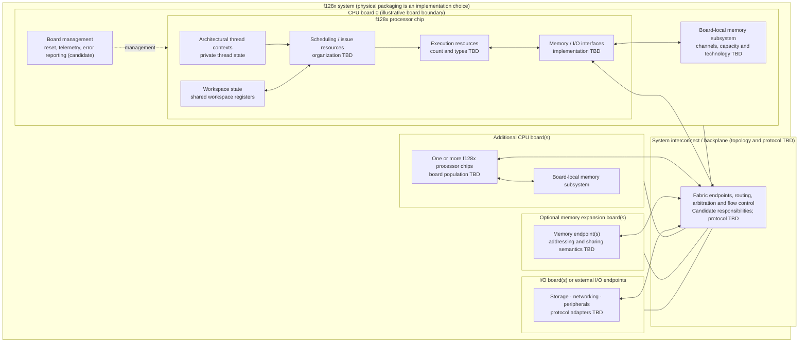

# f128x Physical System Block Diagram 0.1

**Date:** 2026-11-04  
**Status:** Conceptual packaging view; not a frozen chip, board, or interconnect specification

This diagram separates the architectural processor concept from a possible physical implementation. It deliberately does **not** prescribe a number of execution clusters per chip, chips per board, memory capacity, cache levels, link width, clock rate, or backplane topology.

## System view

## Chip-level conceptual boundary

The architecture defines thread and workspace state, but it has not selected a physical microarchitecture. A chip implementation will need to realize at least these responsibilities:

- Maintain or access architectural thread state and workspace-shared state.
- Select eligible threads and issue instructions.
- Execute the selected instruction operations.
- Handle memory and communication requests.
- Preserve architectural behavior across stalls, exceptions, interrupts, and context residency changes.

The scheduler, issue logic, execution units, register storage, caches, memory controllers, and interfaces may be partitioned differently across implementation profiles. The diagram intentionally groups them rather than inventing a fixed cluster count or cache hierarchy.

## Board and backplane responsibilities

A CPU board may contain one or more processor chips and a board-local memory subsystem. The board boundary is a packaging and service boundary, not an architectural workspace or process boundary.

A system interconnect may connect CPU boards to one another and to memory or I/O endpoints. The current board/backplane simulator is a simplified sensitivity model, not a selected electrical design. Its full-duplex request/response lanes, per-board memory service lane, and logarithmic hop proxy are **simulation assumptions**, not a hardware contract.

Potential platform responsibilities include:

- Clock and reset distribution.
- Power sequencing and monitoring.
- Board discovery and inventory.
- Link training, routing, arbitration, and flow control.
- Error detection, reporting, and recovery.
- Firmware boot and platform management.
- Hot-plug and failure handling, if supported.

These are design topics, not claims that the current architecture already specifies them.

## Explicitly not decided

- Number of chips per board or boards per system.
- Number and organization of execution clusters per chip.
- Physical register-file organization or context residency.
- Cache hierarchy, coherence, and memory consistency.
- Address widths, address translation, and memory protection implementation.
- Board-local versus system-wide memory semantics.
- Backplane topology, link width, signaling, bandwidth, and latency.
- Whether memory and I/O use dedicated boards, integrated controllers, or external devices.
- Power, thermal, clocking, packaging, and serviceability constraints.

## Related material

- [Architecture overview 0.1](overview-0.1.md)
- [Context state and residency 0.2](context-state-and-residency-0.2.md)
- [Board and backplane simulation 0.1](../research/board-backplane-simulation-0.1.md)
- [Logical data paths 0.1](data-paths-0.1.md)
