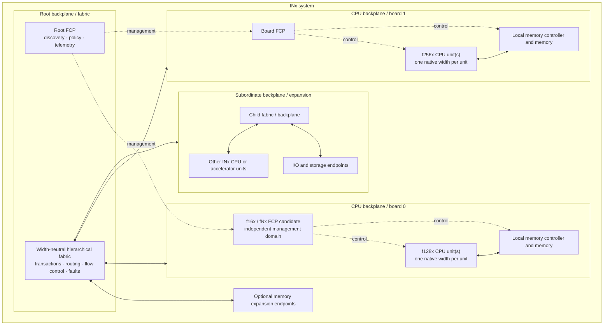

# fNx Physical System Block Diagram 0.2

**Date:** 2026-11-05  
**Status:** Conceptual packaging view; not a frozen chip, board, or interconnect specification

The fNx family permits different native-width CPU units to coexist in a system. Each CPU unit has exactly one native width N. Width interoperability is provided by a common width-neutral fabric and management contract, not by mixing native widths inside one CPU unit.

## System view

The diagram is a conceptual hierarchy. It does not prescribe chip count, board population, FCP count, link width, memory capacity, cache levels, clock rate, signaling, or topology.

## Architectural and physical boundaries

The architecture defines the behavior visible to software. A physical chip may partition:
- Architectural thread and workspace state.
- Context residency and backing.
- Scheduling and issue resources.
- Execution units.
- Register storage and access networks.
- Memory translation and protection.
- Cache and memory interfaces.
- Fabric endpoints.

The number and organization of those blocks are implementation choices. A member's N-bit architectural width does not require every memory, link, or peripheral to use an N-bit physical transfer.

## Control processor and management plane

The proposed fNx Control Processor (FCP) is an auxiliary processor using the fNx ISA family. It is a separate CPU unit with its own single native width. It manages discovery, capability inventory, power/reset sequencing, health, telemetry, fault handling, and board/fabric coordination.

The FCP should have sufficiently independent power, clock, reset, and connectivity to manage a board while its main CPUs are unavailable. Exact electrical implementation remains open.

The FCP is not a serial hop for every main-CPU instruction. Main CPUs execute native instructions directly. Application compatibility and instruction expansion belong primarily to the P-Code installer/AOT compiler and runtime. The FCP reports capabilities and provides management services.

See [fNx control processor and management plane](fnx-control-and-management-plane-0.1.md).

## Hierarchical fabric

Backplanes may connect to other backplanes, forming a hierarchy. Each level requires stable endpoint identity, discovery, address/routing domains, capability propagation, flow control, error reporting, reset boundaries, and fault containment.

Different fNx widths communicate through a common width-neutral protocol. Wider local operations may be segmented only when memory ordering and atomicity rules allow it. A multi-transaction transfer is not automatically atomic.

## Simulation boundary

The existing f128x board/fabric experiments model simplified transaction reservations, endpoint service, and topology sensitivity. They are not electrical models or selected hardware contracts. Their results must remain labelled as f128x-oriented simulation results.

## Explicitly not decided

- Exact FCP width, count, redundancy, firmware, and trust model.
- CPU chips per board and execution-cluster topology.
- Context residency and register-file implementation.
- Cache hierarchy, coherence, and memory consistency.
- Physical address width and memory topology.
- Backplane transaction format, physical lanes, signaling, and link rates.
- Hot-plug, redundancy, and serviceability.
- Power, thermal, clocking, and packaging constraints.

## Related material

- [fNx family and architectural contract](fnx-family-and-architectural-contract-0.1.md)
- [fNx control processor and management plane](fnx-control-and-management-plane-0.1.md)
- [fNx P-Code and application compatibility](fnx-pcode-and-compatibility-0.1.md)
- [Logical data paths](data-paths-0.1.md)
- [Board and backplane simulation](../research/board-backplane-simulation-0.1.md)
