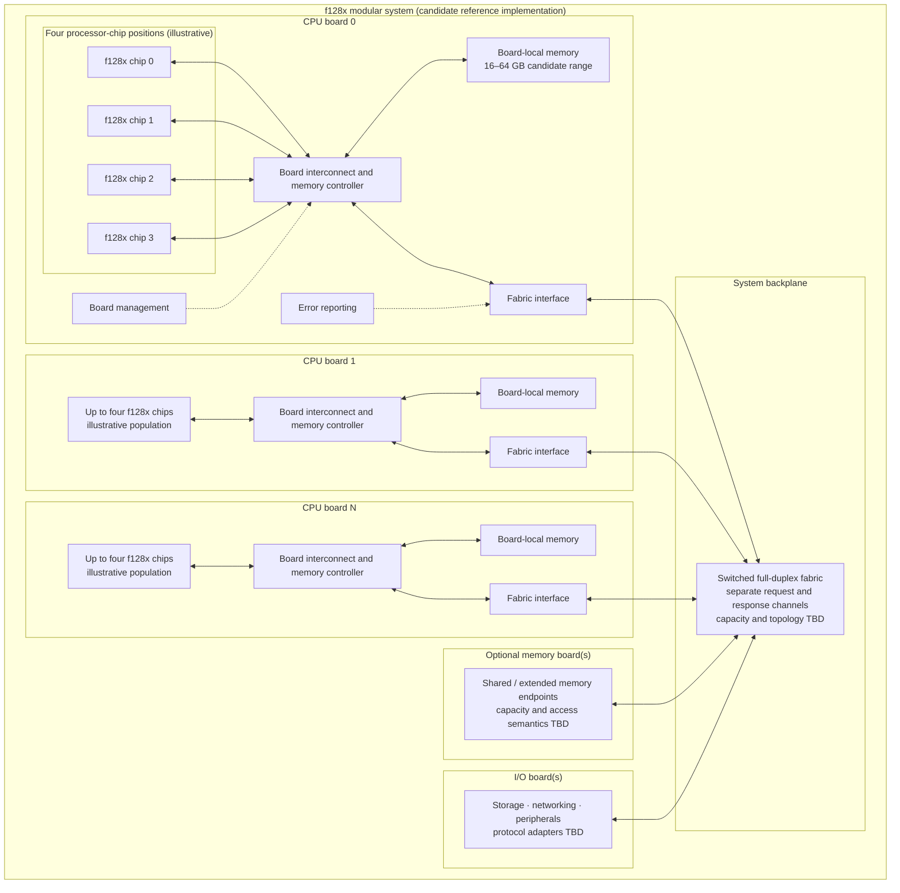
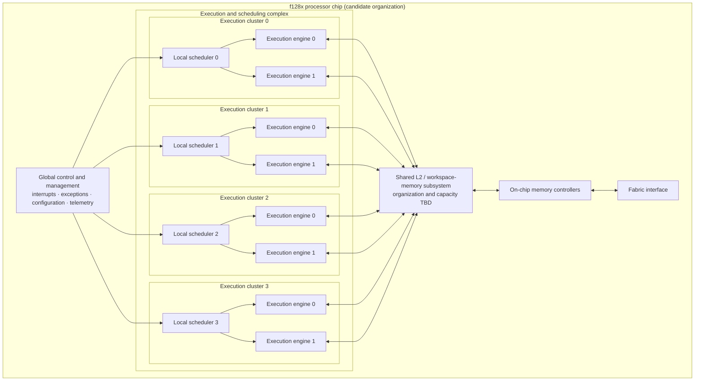

# f128x Reference Implementation Block Diagram 0.1

**Date:** 2026-11-04  
**Status:** Candidate implementation profile; illustrative, not a frozen microarchitecture or platform specification

This document captures the more concrete chip, CPU-board, and system-backplane organization under consideration. It complements, rather than replaces, the conceptual [physical system block diagram](physical-system-block-diagram-0.1.md) and [logical data paths](data-paths-0.1.md).

The diagram is intentionally more specific than the architecture baseline. Its cluster count, engine count, memory capacities, bandwidth, and latency values are candidate parameters that require analysis and simulation. They are not architectural guarantees.

## 1. System and packaging view

## 2. Processor-chip organization

The following is a candidate four-cluster organization. Each cluster is shown with two execution engines and a local scheduler. The exact meaning of an engine, issue width, supported operations, and sharing of execution resources still needs specification.

### Candidate chip parameters

| Element | Candidate profile | Status |
|---|---|---|
| Execution clusters per chip | 4 | Proposed |
| Execution engines per cluster | 2 | Proposed |
| Total execution engines per chip | 8 | Derived from proposed topology |
| Local scheduler | One per cluster | Proposed |
| Global control and management | One logical block per chip | Functional responsibility; physical partition TBD |
| On-chip memory controllers | Present | Organization and channel count TBD |
| Shared L2 / workspace memory | Present | Capacity, banking, latency, and semantics TBD |
| Fabric interface | Present | Protocol and physical implementation TBD |

“Execution engine” is deliberately not equated with a complete independent core. Whether an engine can issue independently, what resources it shares, and how cluster scheduling interacts with global thread eligibility are open microarchitecture questions.

## 3. Candidate memory hierarchy

The illustration suggests three physical levels. This is a working hypothesis, not a finalized cache or memory-coherence specification.

| Level | Candidate location | Intended role | Open questions |
|---|---|---|---|
| Chip-local memory (L1/L2) | Processor chip | Low-latency access to thread/workspace state and cached data | Are L1s present? Is L2 shared across clusters? What is the coherence domain? |
| Board-local memory | CPU board | Capacity memory close to the board's chips | NUMA behavior, controller placement, channels, bandwidth, ECC |
| Shared system memory | Memory board or shared endpoint | Optional expansion beyond board-local capacity | Addressing, routing, coherence, protection, and failure semantics |

The architectural distinction between private registers, workspace-shared registers, private memory, and workspace-shared memory remains separate from this physical hierarchy. A logical memory scope does not by itself dictate which physical level stores the data.

## 4. Candidate CPU-board organization

- Four processor chips per CPU board are shown as an illustrative population.
- A board interconnect connects the chips to the board memory controller and fabric interface.
- Board-local memory is illustrated as 16–64 GB. This is a sizing range for exploration, not a requirement.
- Board management and error reporting are platform responsibilities.
- The board is a packaging, power, cooling, and service boundary. It is not an architectural workspace, process, or mandatory scheduling domain.

The number of chips per board, memory capacity, memory channels, board power envelope, and cooling requirements must be evaluated together.

## 5. Candidate backplane characteristics

The image that motivated this reference profile includes the following candidate targets:

| Characteristic | Candidate value | Qualification |
|---|---:|---|
| Interconnect | Switched, full-duplex | Request and response paths modeled separately |
| Bandwidth | 128 bytes/cycle per direction | Target assumption; not yet validated against a complete fabric design |
| Switch-hop latency | Approximately 32 cycles per hop | Preliminary estimate; topology and clock assumptions unspecified |
| Hop scaling | Related to `log2(number of boards)` | Simplified scaling hypothesis, not a selected routing topology |

These values must not be confused with the current `BoardFabricSweep` simulator's implementation. That simulator has simplified request/response service lanes, destination-board memory service, and a hop proxy. It does not yet establish that this candidate bandwidth or latency is achievable. In particular, propagation and destination-service timing must be corrected and the experiment rerun before using its results to support these targets.

## 6. What must be resolved before treating this as a design

1. Define whether the two engines in a cluster are independently schedulable, independently issuing, or share issue/control resources.
2. Define thread-to-cluster placement, migration, work stealing, and workspace locality.
3. Establish whether local schedulers are autonomous or coordinated by global scheduling/control logic.
4. Specify L1/L2 organization, banking, access ports, latency, and coherence boundaries.
5. Define workspace-memory placement and the relationship between workspace sharing and board boundaries.
6. Specify board memory channels, controller topology, bandwidth, ECC, and NUMA behavior.
7. Choose a switched fabric topology and define link width, signaling, clocking, flow control, routing, and fault handling.
8. Reconcile the 128-byte/cycle/direction and approximately 32-cycle-hop targets with corrected simulator models.
9. Evaluate chip area, register-state implementation, power, thermal density, board power delivery, and cooling.
10. Define boot, reset, interrupts, error containment, and board discovery across multiple chips and boards.

## Related material

- [Physical system block diagram 0.1](physical-system-block-diagram-0.1.md)
- [Logical data paths 0.1](data-paths-0.1.md)
- [Board and backplane simulation 0.1](../research/board-backplane-simulation-0.1.md)
- [Context state and residency 0.2](context-state-and-residency-0.2.md)
